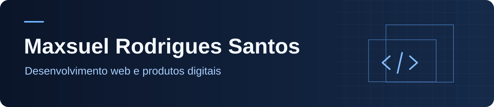

# Maxsuel Rodrigues Santos

**Desenvolvedor Frontend e Full Stack Júnior** · Tupã, SP

Desenvolvo aplicações web e gosto de acompanhar o caminho completo da interface até as regras de negócio. Criei o **Finanças do Max**, para organização financeira pessoal, e desenvolvo o **DuoAgenda** em parceria com meu irmão. Sou técnico em Desenvolvimento de Sistemas e curso Análise e Desenvolvimento de Sistemas.

[LinkedIn](https://www.linkedin.com/in/maxsuel-rodrigues-santos-3422a219a/) · [GitHub](https://github.com/MaxsuelR10)

## Produtos

### DuoAgenda

SaaS de agendamento online para estabelecimentos que atendem com hora marcada. A Área Empresa reúne agenda, serviços e equipe. Pelo link público, o cliente escolhe o atendimento e pode consultar seus horários na Área Cliente.

**React · Vite · Python · FastAPI · Supabase**

[Conhecer o DuoAgenda](https://duoagenda.com.br)

### Finanças do Max

Aplicação web instalável para acompanhar receitas, despesas, contas, cartões e faturas. Trabalhei com regras de parcelamento, importação CSV e sincronização por usuário.

**JavaScript · Node.js · Prisma · Neon/PostgreSQL · Vercel**

## Tecnologias que uso

| Área | Projetos e prática |
| --- | --- |
| Frontend web | HTML, CSS, JavaScript, React, Vite |
| Backend e integração | Python, FastAPI, Node.js, Express, APIs REST |
| Banco e identidade | SQL, PostgreSQL, Supabase, Neon, Prisma |
| Entrega e qualidade | Git, GitHub, Vercel, pytest, Playwright, Node Test Runner |
| Projetos acadêmicos | React Native, Expo e MySQL |

## Projetos técnicos e colaborativos

- [Cabeleleila Leila](https://github.com/MaxsuelR10/teste-dsin-cabeleleila) — desafio técnico de agendamento com React, Node.js, Express e PostgreSQL. Inclui regras de agenda, painel administrativo e testes.
- [Gestoon Web](https://github.com/L1nizera/Gestoon-Web) e [Gestão de Tarefas Mobile](https://github.com/JULIOcesar353/gestao-tarefas-mobile) — contribuições em equipe em um projeto acadêmico de gestão de tarefas, com React na web e React Native/Expo no aplicativo.

## Formação

- **Análise e Desenvolvimento de Sistemas**, Universidade de Marília (Unimar) · cursando
- **Técnico em Desenvolvimento de Sistemas**, ETEC Prof. Massuyuki Kawano · concluído

Busco oportunidades de estágio ou posições júnior em Frontend e Full Stack.

[LinkedIn](https://www.linkedin.com/in/maxsuel-rodrigues-santos-3422a219a/) · [E-mail profissional](mailto:maxsuelrodriguessantos15@gmail.com)
